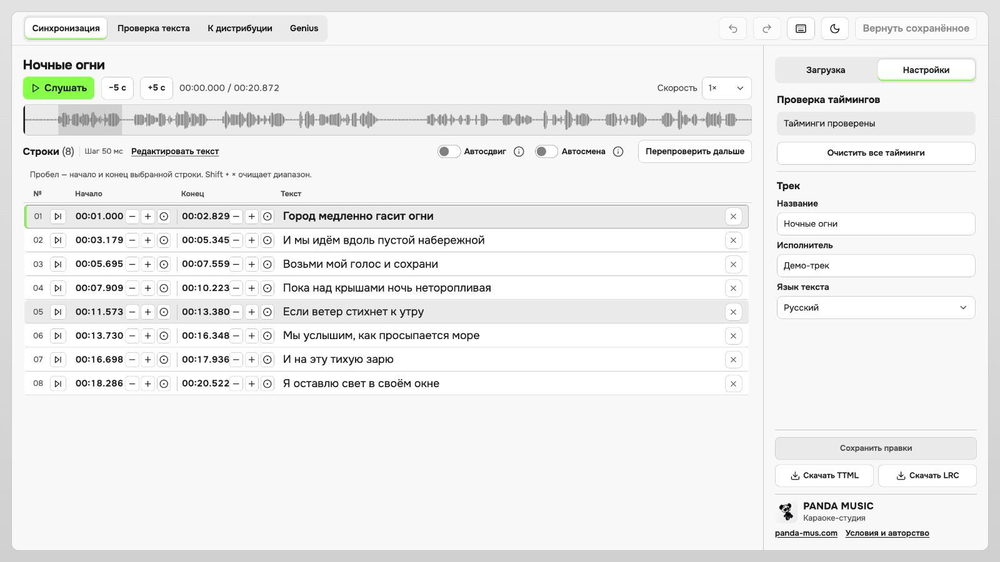

# PANDA MUSIC — Караоке-студия

Бесплатная студия для синхронизации текста с вокалом, экспорта TTML/LRC и подготовки текстов к дистрибуции и для Genius.

## Как запустить

1. **[Скачай ZIP для Windows и Mac](https://github.com/plawzar/panda-music-karaoke/releases/download/v0.1.0-beta.6/PANDA-MUSIC-Karaoke-Studio-Windows-macOS-v0.1.0-beta.6.zip)**.
2. Распакуй ZIP и открой папку **PANDA MUSIC Karaoke Studio**. Дважды щёлкни по файлу для своей системы:
   - **Windows** — `Launch PANDA MUSIC Karaoke - Windows.bat`
   - **Mac** — `Launch PANDA MUSIC Karaoke - Mac.command`
3. Оставь окно запуска открытым. В первый раз нужен интернет для установки. Когда всё готово, студия откроется в браузере. Если вкладка не открылась, [открой студию вручную](http://127.0.0.1:8001/).

Треки, тексты и проекты остаются на компьютере. Лаунчер сам скачивает локальные ИИ-модели для синхронизации и Genius.

ZIP весит меньше 1 МБ. Установка занимает примерно **3–8 ГБ**, с NVIDIA — **15–16 ГБ**. Основной объём занимают модели и зависимости. Режим AMD Radeon экспериментальный.

### Обновление существующей установки

С beta.6 лаунчер предлагает новые версии при запуске и сохраняет проекты и модели. С более ранней версии [обновись вручную один раз](START-HERE.txt).

Сделано вайбкодингом с облачной версией ChatGPT на основе [LRCGen](https://github.com/final-wav/LRCGen). Возможны ошибки. [Сообщить автору @plawzar](https://github.com/plawzar/panda-music-karaoke/issues/new).
